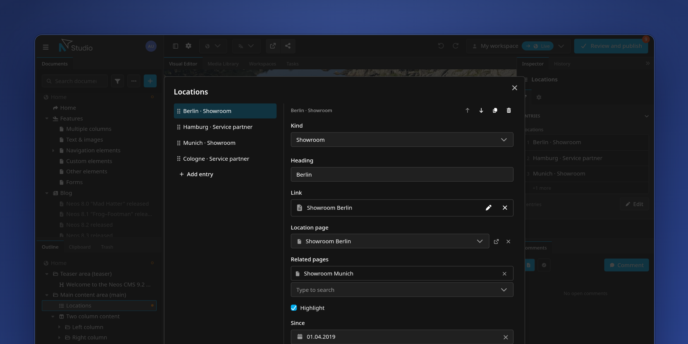

# Beromir.NeosStudio.EntriesEditor



The entries editor for **Neos Studio** (`Medienreaktor.NeosStudio`). It edits
a list of entries - say an icon, a heading and a text, many times over - in
one `array` property, instead of a content collection with child nodes.

The inspector shows a short summary of the list. Editing happens in a dialog:
the entries on the left, the selected entry's fields on the right. Each field
is rendered by a registered Studio property editor (text field, text area,
select box, boolean, link, a reference to a node, or a plugin's editor such as the
[IconSelectEditor](https://github.com/beromir/Beromir.NeosStudio.IconSelectEditor)
or the [ToggleEditor](https://github.com/beromir/Beromir.NeosStudio.ToggleEditor)).
Changes stay in a draft until **Apply**; **Cancel** discards them.

## Installation

Requires Neos Studio 2.10 or later (`medienreaktor/neos-studio` `^2.10`) with
Neos `^9.2` and PHP `^8.4`.

Run the following command in your site package:

```bash
composer require --no-update beromir/neos-studio-entries-editor
```

Then run `composer update` in your project root and flush the Flow caches.
The package adds its labels to the backend translations; if they show up in
English only, flush the XLIFF cache once:

```bash
./flow flow:cache:flushone Neos_Neos_XliffToJsonTranslations
```

## Usage

```yaml
'Vendor.Site:Content.FeatureList':
  superTypes:
    'Neos.Neos:Content': true
  properties:
    features:
      type: array
      ui:
        label: 'Features'
        reloadIfChanged: true
        inspector:
          group: 'general'
          editor: 'Beromir.EntriesEditor/Editor'
          editorOptions:
            dialogTitle: 'Vendor.Site:NodeTypes.Content.FeatureList:features'
            labelTemplate: '{heading}'
            addLabel: 'Add feature'
            fields:
              icon:
                label: 'Icon'
                editor: 'Medienreaktor.IconSelectEditor/Editor'
                editorOptions:
                  iconSources: ['icons']
              heading:
                label: 'Heading'
                validation:
                  'Neos.Neos/Validation/NotEmptyValidator': []
              text:
                label: 'Text'
                editor: 'Neos.Neos/Inspector/Editors/TextAreaEditor'
              highlight:
                type: boolean
                label: 'Highlight'
                defaultValue: false
```

### Editor options

| Option          | Default                 | Description |
| --------------- | ----------------------- | ----------- |
| `fields`        | -                       | The fields of one entry, keyed by name, in display order (see below). |
| `labelTemplate` | `'{<first field>}'`     | The row label, with `{field}` placeholders, e.g. `'{heading} – {subline}'`. Values show as their editors show them (see [Row labels](#row-labels)). Rows whose placeholders are all empty read "Entry 3". |
| `labelValues`   | `formatted`             | `raw` shows values as stored in row labels and the summary, as in 1.x. |
| `dialogTitle`   | the property label      | Plain text or a translation id (`Package:Source:id`). |
| `dialogSize`    | `xl`                    | `lg`, `xl` or `full`. |
| `addLabel`      | "Add entry"             | Plain text or a translation id. |
| `summaryRows`   | `3`                     | How many entries the inspector summary lists before "+N more". |

### Field options

| Option          | Default                       | Description |
| --------------- | ----------------------------- | ----------- |
| `label`         | the field name, humanized     | Plain text or a translation id (`Package:Source:id`). |
| `type`          | `string`                      | Handed to the editor as `subject.type`; also picks the default editor (`string`, `integer`: text field, `boolean`: checkbox, `array`: select box, `DateTime`: date picker, `reference`, `references`: reference editors, see [References to nodes](#references-to-nodes)). |
| `editor`        | by `type`                     | Any registered Studio property editor id. |
| `editorOptions` | `{}`                          | Passed to that editor, as for a node property. |
| `validation`    | `{}`                          | Validators as for a node property, e.g. `'Neos.Neos/Validation/StringLengthValidator': {maximum: 80}`. Every entry is validated on each change and Apply stays disabled until all are valid. Errors show under the field and mark the row once the field was edited or left, or Apply was tried; stored entries show theirs right away. |
| `defaultValue`  | -                             | The value a new entry starts with. |

Supported are editors that store plain values: `TextFieldEditor`,
`TextAreaEditor`, `SelectBoxEditor`, `BooleanEditor`, `DateTimeEditor`,
`LinkEditor` (see [Links](#links)), `ReferenceEditor` and `ReferencesEditor`
(see [References to nodes](#references-to-nodes)) and plugin editors such as
the IconSelectEditor and the ToggleEditor. Not supported:

- `ImageEditor`, `AssetEditor`: an `array` property is stored as plain JSON,
  so an image is kept as `{"id": "<uuid>"}` and is neither resolved to an
  asset in Fusion nor counted as an asset usage.

To limit how many entries a list may have, use a validator on the property
itself, e.g. `'Neos.Neos/Validation/CountValidator': {minimum: 1, maximum: 6}`.

### Row labels

Row labels in the dialog and the inspector summary show each value as its
field's editor shows it, through the editor's `formatValue` (Studio 2.9):

| Editor             | Shows |
| ------------------ | ----- |
| `SelectBoxEditor`  | The option's label, translated; for a data source, the label it returns. |
| `BooleanEditor`    | The field's label when checked, nothing when not. |
| `DateTimeEditor`   | The date in the field's `editorOptions.format`. |
| `LinkEditor`       | The page's title for `node://`, the asset's title for `asset://`, other links as stored. |
| `ReferenceEditor`, `ReferencesEditor` | The target's label (several joined with commas). |
| Plugin editors     | Their own label if they implement `formatValue`, else the value as stored. |

Labels that need a lookup (pages, assets, data sources) show the stored
value until they are resolved. Lookups for all rows go out together and
are cached, so typing in a field doesn't refetch them. A row whose link
or reference points at a removed page or asset reads "Missing" there and
gets a warning icon.

Empty placeholders stay empty, so a template like `'{heading} · {highlight}'`
reads "Berlin · " for an unchecked box. Put optional fields last, or leave
them out of the template. Set `labelValues: raw` to show values as stored.

### Links

The `LinkEditor` stores a link as a plain string, as for a node property:
`node://<id>`, `asset://<id>`, a URL, `mailto:…` or `tel:…`. Its
`editorOptions` work as for a node property: `assets: false` hides the Media
tab, `nodeTypes` limits the pages a link can point at, `placeholder` labels
the empty field. The link dialog shows the pages of the edited node's
workspace and dimension.

```yaml
link:
  label: 'Link'
  editor: 'Neos.Neos/Inspector/Editors/LinkEditor'
  editorOptions:
    assets: false
```

**Asset usage:** Neos only counts asset usage for string properties and
typed collections (`AssetUsageIndexingService::extractAssetIds`), not for
values inside an `array` property. An `asset://` link in an entry is not
listed as a usage of that asset, and the Media module lets the asset be
deleted. Set `assets: false` when that matters.

### References to nodes

Studio's `ReferenceEditor` and `ReferencesEditor` work as entry fields. In
an entry they store the target's node aggregate id as a plain string, or a
list of ids for `ReferencesEditor`. These are deliberately not Neos graph
references: the id is only resolved when the page renders.

```yaml
location:
  type: reference
  label: 'Location'
  editorOptions:
    nodeTypes: ['Vendor.Site:Document.Location']
related:
  type: references
  label: 'Related pages'
```

`type: reference` picks the `ReferenceEditor` and `type: references` the
`ReferencesEditor`. The field is still stored as an id or a list of ids: the
entries editor hands the editors `string` and `array` as the type, which is
what puts them in value mode (Studio 2.10). Setting `editor` to one of them
works the same. Their `editorOptions` work as for a node property:
`nodeTypes`, `threshold`, `placeholder`, `dataSourceIdentifier`.

The search covers the current site, in the edited node's workspace and
dimension. When a stored id no longer resolves (the target was removed),
the field shows "Missing" and the row "Missing" with a warning icon. The id
is kept until you pick another node or remove it. A hidden target is still
found and is marked hidden.

Compared with a `reference` property, you give up:

- backlinks: Neos doesn't know which nodes point at the target, so it has no
  "used by" list and no `filterByReference` query;
- delete warnings: removing the target doesn't warn about the entries
  pointing at it, and the content stays published with the id.

Unlike a graph reference, an entry may point at a node that only exists in
another dimension or workspace. It is then simply not rendered there.

## Editing

The inspector lists the first entries (see `summaryRows`) and the number of
entries. Click an entry or **Edit** to open the dialog:

- **Add** appends an entry that starts with each field's `defaultValue`. An
  empty list opens with one new entry; Apply saves it even when left as is.
- Reorder entries by dragging them, with the arrow buttons above the form,
  or with Alt+Up and Alt+Down on a focused entry. Up and Down move between
  entries, Enter or a click selects one and focuses its first field.
- **Duplicate** copies the selected entry with a new `_id`, **Delete**
  removes it.
- **Apply** saves the whole list as one change; without changes it only
  closes the dialog. **Cancel**, Escape and the close button discard the
  draft, asking first when it has changes.

## Stored value

The property holds an array of objects. Every entry has a generated `_id`
that stays the same when entries are reordered, so it can also serve as a
stable anchor or key in your markup:

```json
[
  {"_id": "3f0c…", "icon": "icons:bolt", "heading": "Fast", "text": "…", "highlight": false},
  {"_id": "9a41…", "icon": "icons:lock", "heading": "Secure", "text": "…", "highlight": true}
]
```

A link field stores its link as a string, a reference field the target's
node aggregate id (a list of them with `multiple`):

```json
{"_id": "5b2e…", "link": "node://a3474e1d-…", "location": "cad56162-…", "related": ["cad56162-…", "b3181965-…"]}
```

Keys that are not (or no longer) configured as fields are kept when an entry
is edited, so renaming a field in the node type never deletes content. Move
existing values to the new name with a node migration.

## Rendering

```fusion
prototype(Vendor.Site:Content.FeatureList) < prototype(Neos.Neos:ContentComponent) {
    features = ${q(node).property('features') || []}

    renderer = afx`
        <ul>
            <Neos.Fusion:Loop items={props.features}>
                <li>
                    <Neos.Fusion:Template @if={item.icon} templatePath={IconSelect.resourceUri(item.icon)} />
                    <h3>{item.heading}</h3>
                    <p>{item.text}</p>
                </li>
            </Neos.Fusion:Loop>
        </ul>
    `
}
```

### Links and references

A link field holds the same string a `LinkEditor` property does, so convert
it with `Neos.Neos:ConvertUris`. `forceConversion` makes it convert in the
backend preview too. A `node://` link whose page is gone converts to an
empty string:

```fusion
prototype(Vendor.Site:Helper.EntryLink) < prototype(Neos.Fusion:Component) {
    uri = null
    href = ${this.uri}
    href.@process.convert = Neos.Neos:ConvertUris {
        forceConversion = true
    }

    renderer = afx`<a @if={props.uri && props.href} href={props.href}>{props.content}</a>`
}
```

To read the link's target itself, e.g. a page's title, use
`${Neos.Link.convertUriToObject(item.link, node)}`. It returns the node or
the asset, or null when it is gone.

A reference field holds an id. Resolve it in the site and skip it when it no
longer resolves:

```fusion
prototype(Vendor.Site:Helper.EntryLocation) < prototype(Neos.Fusion:Component) {
    id = null
    target = ${this.id ? q(site).find('#' + this.id).get(0) : null}

    renderer = Neos.Neos:NodeLink {
        @if.found = ${props.target}
        node = ${props.target}
    }
}
```

The element's cache entry doesn't know about the targets, so tag it with
each id. A change to the target, including its removal, then flushes the
page. `Neos.Caching.nodeTagForIdentifier()` works for a removed node too,
since it only needs the id:

```fusion
prototype(Vendor.Site:Content.Locations) < prototype(Neos.Neos:ContentComponent) {
    @cache {
        mode = 'cached'
        entryIdentifier.node = ${Neos.Caching.entryIdentifierForNode(node)}
        entryTags {
            node = ${Neos.Caching.nodeTag(node)}
            # One tag list for all entries: entryTags flattens one level only.
            targets = ${Array.reduce(q(node).property('items') || [], (tags, item) => item.location ? Array.concat(tags, Neos.Caching.nodeTagForIdentifier(item.location, node)) : tags, [])}
        }
    }
}
```

For a `multiple` field, concatenate the tags of every id in `item.related`
the same way.

## Conflicts

In a collaborative (shared) workspace, Studio keeps the property's stored
value up to date while the dialog is open. If someone else saves the same
list in the meantime, the dialog shows a notice and Apply waits until you
choose **Load theirs** (replaces your draft) or **Keep mine** (your draft
overwrites their change on Apply).

## Development

The Studio plugin lives in `Resources/Private/Plugin` and is built into
`Resources/Public/Plugin`:

```bash
cd Resources/Private/Plugin
npm install
npm run build   # or: npm run dev
npm test
```

## License

GPL-3.0-or-later, see [LICENSE](LICENSE).
